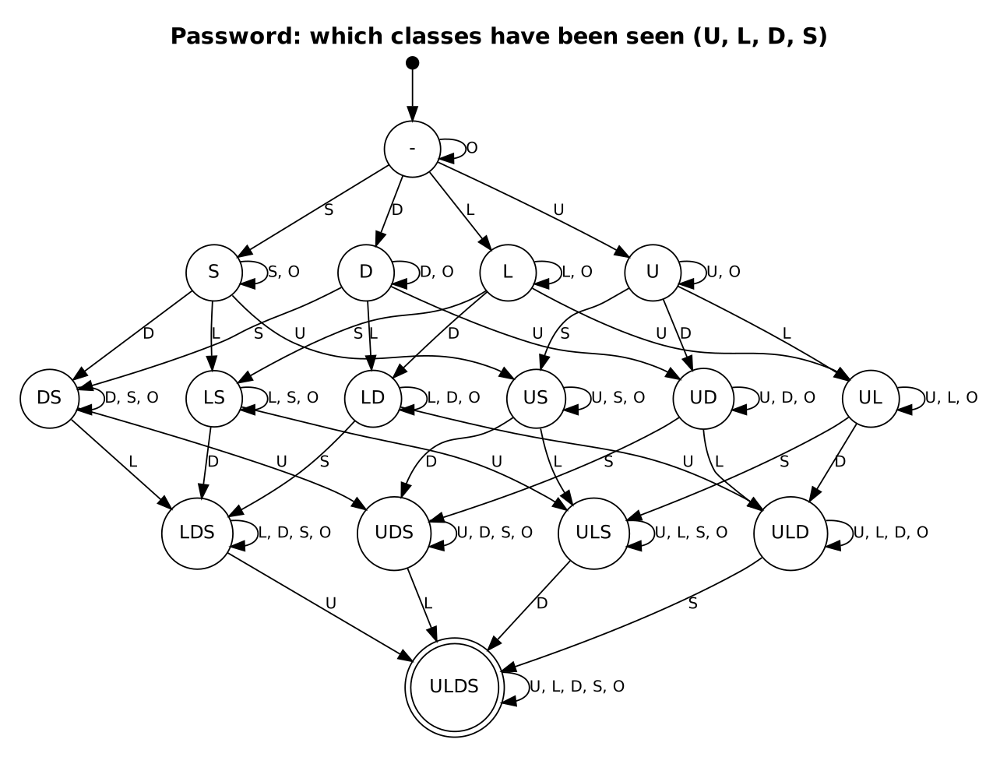
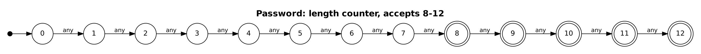
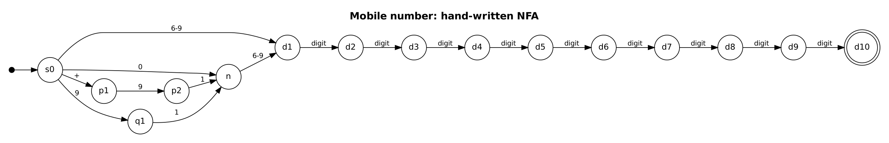
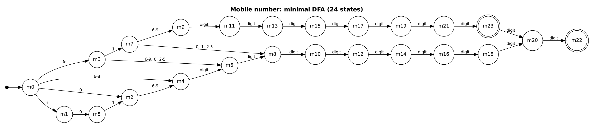
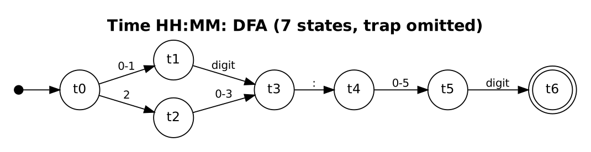

# Finite Automata for Real-Time Validation

**Course:** 21CSC301T Formal Language and Automata, CLA-2, Assessment Task 2
**Student:** Rushdham Malik C K ([RA2411026050221]), B.Tech CSE (AI & ML), III year
**Faculty:** Dr. C. Gunasundari, SRM IST Tiruchirappalli

This repo has finite automata for three input checks that every sign-up or booking form needs:

| # | Application | Automaton | Live states |
|---|-------------|-----------|-------------|
| 1 | Password policy (8-12 characters, four character classes) | 6 small DFAs, then their product, then minimised | 22 → 164 → 136 |
| 2 | Indian mobile number (optional `+91`, `91` or `0` prefix) | hand-written NFA → subset construction → minimal DFA | 15 → 24 → 24 |
| 3 | Time `HH:MM` (24-hour) | DFA | 7 |

Every automaton runs on real strings. The test suite also compares each one with an independently written regular expression on about 195 000 generated strings, so the diagrams are backed by evidence and not only drawn.

## Run it

```
python -m fa_validators.cli                       # every application, accept/reject table
python -m fa_validators.cli mobile 919876543210   # one string, full transition trace
python -m fa_validators.cli --stats               # design comparison (state counts)
python -m fa_validators.cli --limits              # what each automaton cannot check
python -m unittest -v                             # 13 tests (pytest also works)
python tools/make_diagrams.py                     # rebuild diagrams + web demo (needs Graphviz)
```

No packages are needed to run the automata or the tests. To see the **browser demo**, open `docs/index.html`: pick an application, type a string, and the page highlights the current state on the diagram and lists every transition taken.

All machines read *character classes*, not raw characters. For example `U` means any upper-case letter. This keeps the diagrams readable. Any move that is not drawn goes to a trap state `qD` that never accepts.

## 1. Password policy

Policy: 8 to 12 characters, at least one upper-case letter, one lower-case letter, one digit and one special character from `@ # $ % & * !`. Nothing else is allowed, so a space is rejected.

- Σ = {U, L, D, S, O}, where O is any other character
- L = L_U ∩ L_L ∩ L_D ∩ L_S ∩ L_length ∩ L_charset

Each condition is a tiny DFA: 2 states for "contains a U", 13 for the length counter, 1 for "only allowed characters". Regular languages are closed under intersection, so the product construction gives one DFA for the whole policy. The part that remembers which classes were seen is a 16-state lattice:





| Design | Live states |
|---|---|
| 6 small DFAs run side by side | 22 |
| Product DFA (reachable part) | 164 |
| Product after minimisation | 136 |

The single DFA is the formal answer. Running the small DFAs in parallel is the same machine in practice and is much easier to change when the policy changes.

## 2. Mobile number

Rule: an optional prefix `+91`, `91` or `0`, then ten digits that start with 6, 7, 8 or 9. As a regular expression: `(\+91|91|0)?[6-9][0-9]{9}`.

The natural machine is an **NFA**, because the digit `9` at the start is ambiguous. It can be the first character of the prefix `91`, or the first digit of the number itself. Both readings are valid: `9198765432` is a 10-digit number that happens to start with 91, and `919876543210` is the prefix `91` followed by `9876543210`. The NFA follows both readings at once (the two moves out of `s0` on `9`):



Subset construction turns the guess into explicit states such as `{d1,q1}` (could be a number digit or the prefix) and `{d2,n}` (a prefix was just completed, so a new number may start). It gives 24 states, and minimisation finds nothing to merge, so the minimal DFA also has 24 states:



## 3. Time HH:MM

Rule: hours 00 to 23, a colon, minutes 00 to 59. The first hour digit decides what the second may be: after 0 or 1 any digit is fine, after 2 only 0 to 3.



| State | Meaning |
|---|---|
| t0 | start |
| t1 | hour starts with 0 or 1 |
| t2 | hour starts with 2 |
| t3 | hour complete, expects `:` |
| t4 | colon read, expects 0-5 |
| t5 | minute tens digit read |
| t6 | complete: **accept** |

## Syntax vs. semantics

The automaton answers "is this string *shaped* correctly?" It cannot answer:

- whether a password is common, leaked, or the same as the user name (needs a list or the account record),
- whether a mobile number is allocated, active, or belongs to this user (needs the operator or an OTP),
- whether a time slot is free, in the past, or in another time zone (needs a calendar and a time library),
- rules that need unbounded counting, for example "as many digits as letters". These are not regular, as the pumping lemma shows.

NIST SP 800-63B also advises against strict composition rules for passwords, so in a real system the policy above would be combined with a length minimum and a blocklist. The full list of limitations is printed by `python -m fa_validators.cli --limits`.

## Layout

```
fa_validators/automata.py    DFA, NFA, product, complement, minimisation, subset construction, DOT export
fa_validators/validators.py  the three applications, classifiers, test strings, limitations
fa_validators/cli.py         terminal demo
tests/                       unittest suite (listed examples + exhaustive and random cross-checks)
tools/make_diagrams.py       builds docs/diagrams/* and docs/index.html
tools/demo_template.html     page template for the browser demo
docs/                        diagrams and the browser demo
```
